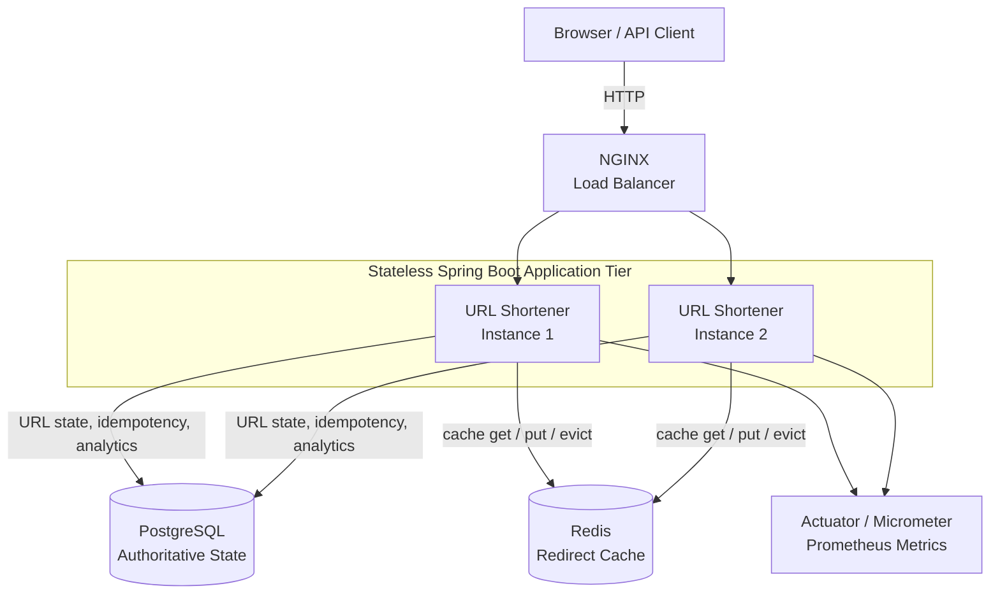
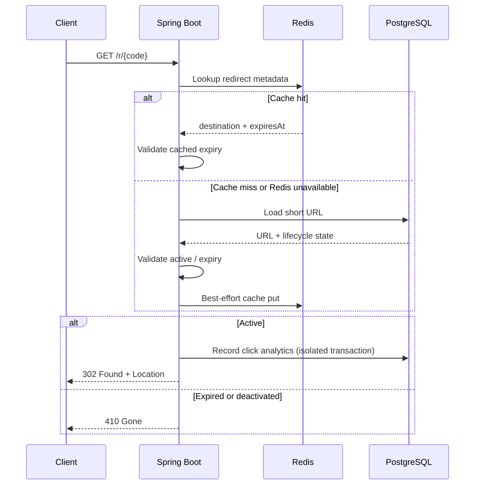
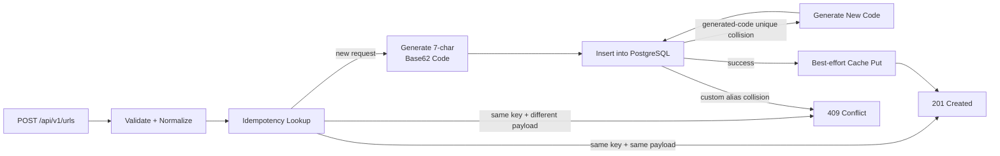
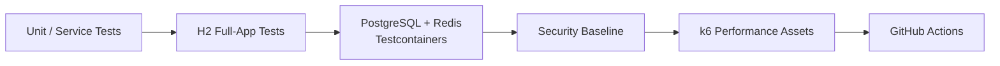
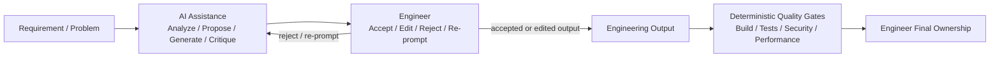

# ShortPath — AI-Assisted URL Shortener

> **A production-minded URL shortener built with Java 21 and Spring Boot 4.1, developed through an engineer-led, AI-assisted software engineering workflow.**


The product is the URL shortener. AI is an engineering accelerator—not an autonomous software-development system. AI helped with requirement analysis, decomposition, implementation options, debugging, test generation, documentation, and review preparation. **The engineer retained ownership of scope, architecture, implementation decisions, validation, risk acceptance, and final quality.**

---

## Why this repository exists

This project demonstrates five things together:

1. A **runnable end-to-end URL shortener** with a browser interface.
2. **Production-minded backend engineering**: correctness, failure behavior, caching, idempotency, analytics, and observability.
3. A clear **architecture and decision trail**, including what was deliberately not added.
4. Three required engineering scenarios: **greenfield, brownfield, and ambiguous requirement**.
5. **Engineer-led AI-assisted execution** with documented accepted, edited, rejected, and re-prompted recommendations.

A direct assignment-to-evidence map is available in [`docs/DELIVERABLES.md`](docs/DELIVERABLES.md).

---

# 30-second reviewer summary

| Capability | Implementation |
|---|---|
| URL shortening | 7-character Base62 codes generated with `SecureRandom` |
| Redirect | HTTP `302 Found` to original destination |
| Browser UI | Create, recent links, lifecycle status, analytics, deactivate |
| Persistence | PostgreSQL in production-like modes; H2 for zero-infrastructure demo |
| Cache | Redis cache-aside redirect optimization with DB fallback on miss/error |
| Analytics | Aggregate trends + referrer/browser breakdown + detailed click events |
| Link lifecycle | `ACTIVE`, `EXPIRED`, `DEACTIVATED` |
| Link controls | Expiration, custom aliases, soft deactivation |
| Reliability | Idempotency key + request fingerprint + generated-code collision retry |
| Validation | URL normalization, unsafe target rejection, alias validation, structured errors |
| Scale-out demo | NGINX + two stateless application instances + shared PostgreSQL/Redis |
| Testing | JUnit, H2 full-app tests, PostgreSQL/Redis Testcontainers |
| Performance | k6 smoke/create/redirect assets with explicit thresholds |
| Observability | Actuator, Micrometer/Prometheus, cache/analytics metrics, instance headers |
| AI usage | Engineer-led; decisions and rationale documented |
| Required scenarios | Greenfield, brownfield, ambiguous-requirement |

---

# Quick start

## Option A — fastest path: Java + Maven only

The default profile runs with **embedded H2** and **Redis disabled**, so no Docker, PostgreSQL, or Redis is required.

```bash
mvn -pl url-shortener spring-boot:run
```

Open:

- **Product UI:** http://localhost:8082
- **Health:** http://localhost:8082/actuator/health
- **H2 console:** http://localhost:8082/h2-console

Equivalent helper:

```bash
./scripts/run-local.sh
```

## Option B — standalone JAR

```bash
./scripts/run-standalone.sh
```

## Option C — local PostgreSQL, no Docker

```bash
brew install postgresql@16
brew services start postgresql@16
./scripts/setup-local-postgres.sh
./scripts/run-postgres.sh
```

Redis is still optional. To exercise the cache:

```bash
brew install redis
brew services start redis
SHORT_URL_CACHE_ENABLED=true ./scripts/run-postgres.sh
```

## Option D — scale-out demonstration

With Docker available:

```bash
docker compose up --build
```

Open:

```text
http://localhost:8080
```

Verify requests reach both instances:

```bash
./scripts/demo-scale.sh
```

Every response includes `X-App-Instance` so load distribution is visible.

---

# Product behavior

The browser UI and REST API support:

- random 7-character short-code generation
- custom aliases
- optional expiration
- direct redirects
- recent-link lifecycle display
- aggregate analytics
- detailed click-event analytics
- soft deactivation
- request idempotency
- structured validation/error responses

A full API reference is in [`docs/API.md`](docs/API.md).

---

# Runtime architecture

The default local mode is intentionally simple, but the repository also includes a production-like scale-out topology.



### Architectural boundaries

- **PostgreSQL is the system of record** for links, uniqueness, idempotency, lifecycle state, and analytics.
- **Redis is a latency optimization**, not durable state. Cache miss or Redis failure falls back to PostgreSQL.
- **Application instances are stateless**, so horizontal scale-out does not rely on instance-local sessions.
- **Analytics storage is isolated from redirect correctness**; a database error while recording a click is metered rather than converted into a redirect failure.
- **H2 is a developer/demo profile**, not a substitute for PostgreSQL compatibility testing.

One deliberate prototype trade-off: deactivation uses best-effort cache eviction. If Redis invalidation fails after a previously cached redirect, stale data can survive until the configured cache TTL. That limitation is documented rather than hidden; a production evolution could add versioned cache entries, event-driven invalidation, or a shorter revocation-specific TTL.

Full rationale: [`docs/ARCHITECTURE.md`](docs/ARCHITECTURE.md).

---

# Redirect control flow

Redirect is the highest-value read path, so cache behavior and failure semantics are explicit.



### Redirect semantics

| Condition | Result |
|---|---|
| Unknown code | `404 Not Found` |
| Active code | `302 Found` |
| Expired code | `410 Gone` |
| Deactivated code | `410 Gone` |
| Redis unavailable | DB fallback |
| Analytics persistence error | Redirect remains primary availability path; failure metric increments |

---

# Create control flow

The create path focuses on validation, retry safety, and database-enforced correctness.



Generated-code correctness ultimately relies on the **database unique constraint**, not a race-prone pre-check. Random collisions are retried with a bounded attempt budget.

---

# Short-code design

Generated codes use:

```text
0-9 A-Z a-z
```

with a default length of **7**, producing:

```text
62^7 = 3,521,614,606,208 possible codes
```

Generation uses `SecureRandom`.

Custom aliases are a separate product path and must match:

```text
[A-Za-z0-9_-]{4,32}
```

---

# Link lifecycle and status consistency

The API exposes both a compatibility `active` boolean and a more expressive lifecycle status:

```text
ACTIVE
EXPIRED
DEACTIVATED
```

Example metadata response:

```json
{
  "code": "annual-report",
  "shortUrl": "http://localhost:8082/r/annual-report",
  "destinationUrl": "https://example.com/reports/2026",
  "createdAt": "2026-10-14T13:00:00Z",
  "expiresAt": "2026-12-31T23:59:59Z",
  "active": true,
  "status": "ACTIVE"
}
```

The browser's **Recent Links** section uses local storage only as demo history; current lifecycle state is refreshed from the backend so the table and analytics view remain consistent after expiration/deactivation.

| Lifecycle | Metadata | Redirect |
|---|---|---|
| Active | `ACTIVE` | `302` |
| Expired | `EXPIRED` | `410` |
| Deactivated | `DEACTIVATED` | `410` |

---

# Analytics

## Aggregate analytics

```http
GET /api/v1/urls/{code}/analytics
```

Returns:

- total clicks
- last-click timestamp
- last-seven-day trend
- top referrer hosts
- browser-family breakdown

## Detailed analytics

```http
GET /api/v1/urls/{code}/analytics/events?limit=25
```

Returns bounded recent click events with:

- timestamp
- referrer host
- coarse browser family

The service intentionally stores coarse browser family rather than the complete User-Agent string to reduce unnecessary fingerprinting data.

---

# Idempotency

Clients can send:

```http
Idempotency-Key: request-123
```

The key is stored with a SHA-256 fingerprint of the normalized create request.

| Request | Behavior |
|---|---|
| same key + same normalized payload | return original result |
| same key + different payload | `409 IDEMPOTENCY_KEY_REUSED` |
| concurrent duplicate create | database uniqueness remains final authority |

This prevents accidental duplicate links when clients retry after timeouts or uncertain responses.

---

# Validation and security posture

Only `http` and `https` destinations are accepted.

Implemented controls include:

- URL normalization
- unsupported-scheme rejection
- localhost rejection
- loopback/private literal-address rejection
- embedded credential rejection
- custom-alias allow-list
- input-size constraints
- structured validation errors
- no secrets required for default demo mode
- coarse analytics metadata rather than raw User-Agent storage
- deterministic testing/security evidence instead of AI self-attestation

The prototype intentionally does **not** claim that lexical URL validation is a complete SSRF defense. DNS resolution and rebinding controls would be required for a stronger production boundary.

See [`docs/SECURITY.md`](docs/SECURITY.md).

---

# Failure model

| Failure / condition | System behavior |
|---|---|
| Unknown short code | `404` |
| Expired link | `410` |
| Deactivated link | `410` |
| Invalid/unsafe destination | `400` structured error |
| Custom alias already exists | `409` |
| Idempotency key reused with different payload | `409` |
| Generated-code collision | bounded regenerate/retry |
| Redis miss | load from PostgreSQL |
| Redis unavailable | continue through PostgreSQL |
| Cache eviction failure | bounded stale-cache risk until TTL; documented limitation |
| Analytics write failure | meter failure; preserve redirect availability path |
| PostgreSQL unavailable | fail rather than treating cache as durable authority |

More detail: [`docs/FAILURE-MODES.md`](docs/FAILURE-MODES.md).

---

# Testing and quality gates

The test strategy deliberately separates **fast feedback** from **environment compatibility**.



## Local tests

```bash
mvn test
```

Covers areas including:

- Base62 short-code generation
- URL safety and normalization
- create/idempotency behavior
- generated-code collision retry
- expiration lifecycle
- custom aliases
- H2 create → redirect → analytics flows

## PostgreSQL + Redis integration

```bash
mvn verify
```

`UrlShortenerIntegrationIT` uses Testcontainers to exercise:

- PostgreSQL schema/migrations
- Redis redirect caching
- API behavior
- analytics
- deactivation
- structured errors

**H2 passing does not imply PostgreSQL compatibility.** That distinction is intentional and documented in ADR-006.

## CI

GitHub Actions runs:

```text
mvn clean verify
→ unit + H2 tests
→ PostgreSQL/Redis Testcontainers
→ security baseline
→ git diff hygiene
→ Docker Compose validation
→ application image build
```

---

# Performance assets

k6 scripts live in [`performance/k6/`](performance/k6/).

Assessment/demo targets:

| Flow | p95 | p99 |
|---|---:|---:|
| Redirect | < 100 ms | < 200 ms |
| Create | < 250 ms | < 500 ms |
| HTTP failure rate | < 1% | — |

Run:

```bash
k6 run performance/k6/smoke.js
SHORT_CODE=<code> k6 run performance/k6/redirect-load.js
k6 run performance/k6/create-load.js
```

These are **explicit engineering targets**, not claims of proven production capacity.

See [`docs/PERFORMANCE.md`](docs/PERFORMANCE.md).

---

# Observability

Spring Boot Actuator exposes:

```text
/actuator/health
/actuator/metrics
/actuator/prometheus
```

Custom signals include:

- redirect cache hits
- redirect cache misses
- redirect cache errors
- analytics write failures

Operational response headers include:

```text
X-Redirect-Cache: HIT | MISS
X-App-Instance: app-1 | app-2 | local-h2 | ...
```

These make cache behavior and scale-out distribution visible during the demo.

---

# AI-assisted engineering approach

The project intentionally uses AI **inside engineer-owned tasks**, rather than handing control of the SDLC to autonomous orchestration.



AI does **not** self-approve code, autonomously merge, deploy, or declare production readiness.

## Decision traceability examples

| AI proposal / assistance | Engineer action | Rationale |
|---|---|---|
| Introduce Kafka for click analytics | **Rejected** | No measured throughput, replay, fan-out, or multi-consumer requirement justified the operational cost |
| Let Redis determine link availability | **Edited** | PostgreSQL remains authoritative; cache failure must degrade safely |
| Assume one interpretation of an ambiguous security requirement | **Re-prompted** | Threat model and compatibility are engineer/product decisions |
| Modify an already-applied Flyway V1 | **Rejected** | Restored immutable V1; correction moved to forward V2 |
| Treat H2 as production DB validation | **Edited** | H2 is fast feedback; PostgreSQL Testcontainers provides compatibility evidence |
| Build autonomous SDLC orchestration | **Rejected / simplified** | Latest requirement explicitly called for engineer-led AI-assisted execution |

Detailed evidence:

- [`docs/AI-ENGINEERING-LOG.md`](docs/AI-ENGINEERING-LOG.md)
- [`docs/PROMPTING-STRATEGY.md`](docs/PROMPTING-STRATEGY.md)
- [`docs/ASSIGNMENT-ALIGNMENT.md`](docs/ASSIGNMENT-ALIGNMENT.md)

---

# Required engineering scenarios

All three scenarios point to **implemented code paths** and include requirement interpretation, decomposition, AI-assisted execution, engineer decisions, changed artifacts, and validation evidence.

| Scenario | Requirement | Engineering signal |
|---|---|---|
| **Greenfield** | Add expiring links | Cross-cutting feature design across API, persistence, cache TTL, lifecycle semantics, and tests |
| **Brownfield** | Make create idempotent under client retries | Existing codebase reasoning, concurrency, request fingerprinting, regression safety |
| **Ambiguous** | “Make short links more memorable” | Identify ambiguity first; engineer defines custom-alias semantics before implementation |

### Greenfield — expiring links

Demonstrates:

```text
Requirement
→ acceptance criteria
→ API + persistence decomposition
→ cache TTL interaction
→ ACTIVE / EXPIRED lifecycle
→ 410 behavior
→ automated validation
```

[`docs/scenarios/GREENFIELD.md`](docs/scenarios/GREENFIELD.md)

### Brownfield — idempotent create

Demonstrates:

```text
Existing create path
→ retry/concurrency failure analysis
→ request fingerprint design
→ database-authoritative constraints
→ race handling
→ regression coverage
```

[`docs/scenarios/BROWNFIELD.md`](docs/scenarios/BROWNFIELD.md)

### Ambiguous — memorable links

Demonstrates:

```text
"Make short links more memorable"
→ AI surfaces ambiguity
→ engineer defines custom-alias contract
→ compatibility + validation rules
→ implementation
→ validation evidence
```

[`docs/scenarios/AMBIGUOUS.md`](docs/scenarios/AMBIGUOUS.md)

One-page scenario map: [`docs/scenarios/README.md`](docs/scenarios/README.md).

---

# Key architecture decisions

| ADR | Decision | Why it matters |
|---|---|---|
| [ADR-001](docs/decisions/ADR-001-engineer-led-ai.md) | Engineer-led AI | AI accelerates tasks; engineer owns execution and quality |
| [ADR-002](docs/decisions/ADR-002-postgres-authority-redis-cache.md) | PostgreSQL authority, Redis cache | Separate correctness from latency optimization |
| [ADR-003](docs/decisions/ADR-003-no-kafka-without-evidence.md) | No Kafka without evidence | Avoid distributed-systems complexity without a demonstrated requirement |
| [ADR-004](docs/decisions/ADR-004-quality-evidence-independent-of-ai.md) | Validation independent of AI | Tests/tools—not model confidence—establish evidence |
| [ADR-005](docs/decisions/ADR-005-immutable-flyway-migrations.md) | Flyway migrations immutable | Applied schema history moves forward, never rewritten |
| [ADR-006](docs/decisions/ADR-006-h2-is-not-postgres-evidence.md) | H2 != PostgreSQL evidence | Fast local mode and compatibility validation serve different purposes |
| [ADR-007](docs/decisions/ADR-007-stateless-scale-out-behind-nginx.md) | Stateless scale-out | Shared authoritative state allows multiple interchangeable app instances |

---

# Deliberate non-decisions

This repository avoids infrastructure that would add complexity without improving the demonstrated requirements.

| Not added | Reason |
|---|---|
| Kafka | No demonstrated need for replay, fan-out, multiple consumers, or event-stream throughput |
| Kubernetes | Not needed to demonstrate stateless scale-out or application behavior |
| Separate analytics database | Current analytics volume does not justify an independent storage platform |
| Authentication / tenancy | Outside the base URL-shortener scope; explicitly documented as future evolution |
| Autonomous AI orchestration | Conflicts with the engineer-led execution objective |

The design goal is **appropriate complexity**, not maximum component count.

---

# Runtime profiles

| Profile | Database | Redis | Flyway | Intended use |
|---|---|---|---|---|
| Default | H2 | Disabled | Disabled | Fast reviewer/local demo |
| PostgreSQL | PostgreSQL | Optional | Enabled | Production-like local validation |
| Scalable | PostgreSQL | Enabled | Enabled | NGINX + two-instance scale-out demonstration |
| Testcontainers | PostgreSQL container | Redis container | Enabled | Automated compatibility/integration validation |

---

# Data model

## `short_url`

```text
id                  UUID PK
short_code          unique
destination_url
created_at
expires_at          nullable
deactivated_at      nullable
idempotency_key     unique, nullable
request_hash        SHA-256, nullable
version             optimistic-lock version
```

## `click_event`

```text
id                  UUID PK
short_url_id        FK
occurred_at
referrer_host       nullable
user_agent_family   nullable
```

PostgreSQL schema changes use **forward-only Flyway migrations**. Once applied, a versioned migration is treated as immutable.

---

# API summary

| Method | Endpoint | Purpose |
|---|---|---|
| `POST` | `/api/v1/urls` | Create a short URL |
| `GET` | `/r/{code}` | Redirect |
| `GET` | `/api/v1/urls/{code}` | Link metadata/lifecycle |
| `GET` | `/api/v1/urls/{code}/analytics` | Aggregate analytics |
| `GET` | `/api/v1/urls/{code}/analytics/events?limit=25` | Detailed click events |
| `DELETE` | `/api/v1/urls/{code}` | Soft deactivate |

Example create:

```bash
curl -i -X POST http://localhost:8082/api/v1/urls \
  -H 'Content-Type: application/json' \
  -H 'Idempotency-Key: demo-001' \
  -d '{
    "url": "https://example.com/reports/2026",
    "customAlias": "annual-report",
    "expiresAt": "2026-12-31T23:59:59Z"
  }'
```

See [`docs/API.md`](docs/API.md) for complete examples.

---

# Repository structure

```text
.
├── README.md
├── START-HERE.md
├── pom.xml
├── Dockerfile.url-shortener
├── docker-compose.yml              # NGINX + 2 apps + PostgreSQL + Redis
├── docker-compose.single.yml       # one-app Docker profile
├── .github/workflows/ci.yml
│
├── url-shortener/
│   ├── pom.xml
│   └── src/
│       ├── main/java/              # controllers, services, persistence
│       ├── main/resources/
│       │   ├── application.yml     # H2 zero-infra default
│       │   ├── application-postgres.yml
│       │   ├── application-scalable.yml
│       │   ├── db/migration/
│       │   └── static/             # browser UI
│       └── test/java/
│
├── infra/nginx/nginx.conf
├── performance/
│   ├── README.md
│   └── k6/
│       ├── smoke.js
│       ├── redirect-load.js
│       └── create-load.js
│
├── scripts/
│   ├── run-local.sh
│   ├── run-postgres.sh
│   ├── run-standalone.sh
│   ├── setup-local-postgres.sh
│   ├── demo-url-shortener.sh
│   ├── demo-scale.sh
│   └── ...
│
└── docs/
    ├── DELIVERABLES.md
    ├── ARCHITECTURE.md
    ├── API.md
    ├── AI-ENGINEERING-LOG.md
    ├── PROMPTING-STRATEGY.md
    ├── FAILURE-MODES.md
    ├── SECURITY.md
    ├── PERFORMANCE.md
    ├── TESTING-AND-TRADEOFFS.md
    ├── VALIDATION.md
    ├── DEMO-RUNBOOK.md
    ├── INTERVIEW-TALK-TRACK.md
    ├── scenarios/
    └── decisions/
```

---

# Limitations and production evolution

This is intentionally **production-minded, not production-complete**.

Current limitations / next steps include:

- cache invalidation after deactivation is best effort; production could use stronger revocation/versioning semantics
- analytics writes are synchronous and stored in the primary relational database; higher measured volume could justify an outbox/event pipeline
- target validation does not implement DNS-resolution/rebinding protection
- detailed analytics are bounded recent-event queries rather than a dedicated analytics system
- NGINX is a scale-out demonstration, not a complete ingress/WAF deployment
- no authentication/authorization or multi-tenant ownership model
- no global/custom-domain routing strategy
- no multi-region replication or globally distributed ID allocation

The design intentionally documents these boundaries rather than adding infrastructure without evidence.

---

# Assignment deliverables

| Deliverable | Evidence |
|---|---|
| Working prototype, runnable end-to-end | Browser UI + REST API + H2 zero-infra mode + PostgreSQL mode |
| Architecture overview | This README + [`docs/ARCHITECTURE.md`](docs/ARCHITECTURE.md) + ADRs |
| Greenfield scenario | [`docs/scenarios/GREENFIELD.md`](docs/scenarios/GREENFIELD.md) |
| Brownfield scenario | [`docs/scenarios/BROWNFIELD.md`](docs/scenarios/BROWNFIELD.md) |
| Ambiguous-requirement scenario | [`docs/scenarios/AMBIGUOUS.md`](docs/scenarios/AMBIGUOUS.md) |
| Setup instructions | Quick Start + [`START-HERE.md`](START-HERE.md) + [`LOCAL-RUN-NO-DOCKER.md`](LOCAL-RUN-NO-DOCKER.md) |
| Testing approach | Testing section + [`docs/TESTING-AND-TRADEOFFS.md`](docs/TESTING-AND-TRADEOFFS.md) |
| Limitations / trade-offs | Limitations section + ADRs + [`docs/FINAL-ENGINEERING-SUMMARY.md`](docs/FINAL-ENGINEERING-SUMMARY.md) |

Complete mapping: [`docs/DELIVERABLES.md`](docs/DELIVERABLES.md).

---

# Five-minute reviewer path

If you only have five minutes:

1. Run:
   ```bash
   mvn -pl url-shortener spring-boot:run
   ```
2. Open **http://localhost:8082**.
3. Create a link, open the redirect, inspect analytics, then deactivate it.
4. Read **Runtime Architecture**, **Redirect Control Flow**, and **Failure Model** above.
5. Review [`docs/AI-ENGINEERING-LOG.md`](docs/AI-ENGINEERING-LOG.md) for accepted/edited/rejected AI decisions.
6. Review [`docs/scenarios/README.md`](docs/scenarios/README.md) for the three assessment scenarios.
7. Review [`docs/TESTING-AND-TRADEOFFS.md`](docs/TESTING-AND-TRADEOFFS.md) for validation depth and limitations.

> **Core engineering thesis:** AI accelerated analysis and implementation, but deterministic evidence and engineering judgment own the result.
