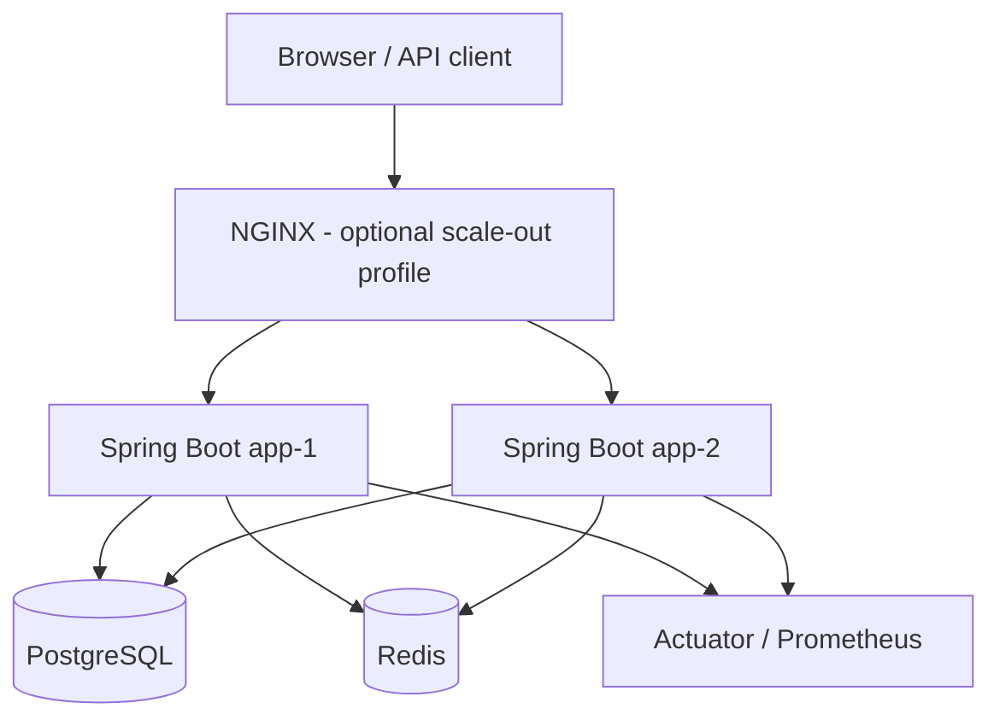
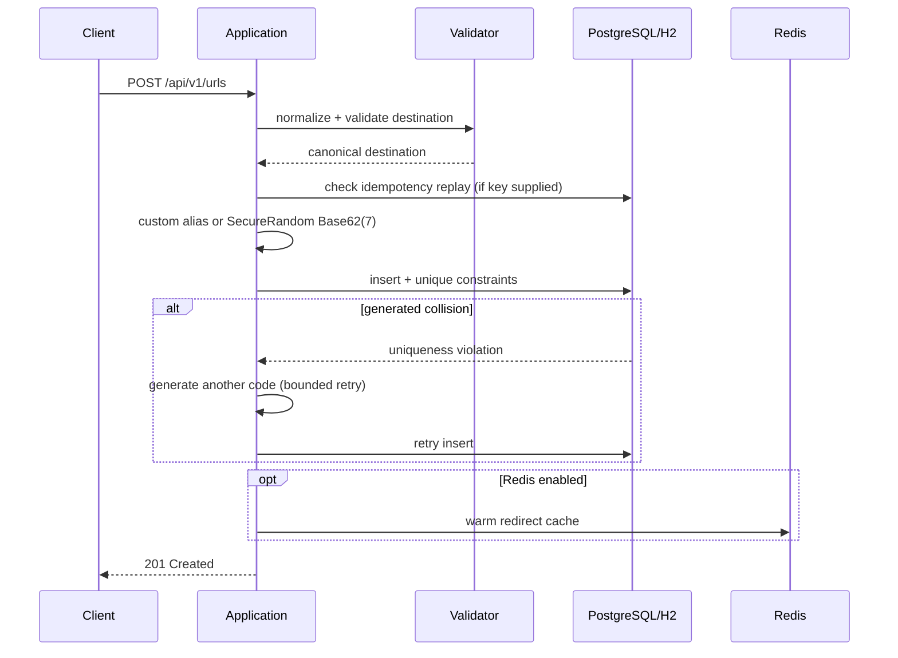
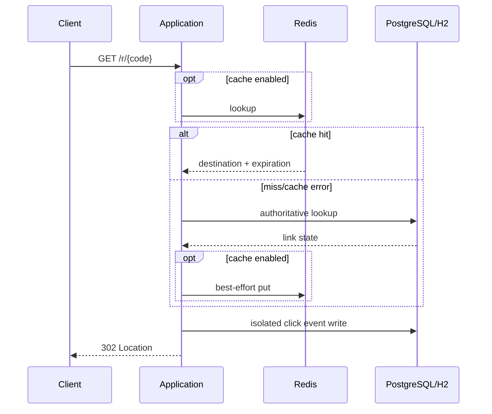

# Architecture

## Context

ShortPath is a URL-shortening service designed to demonstrate production-minded backend engineering while keeping infrastructure proportional to the problem.

The application supports two primary runtime modes:

1. **Zero-infrastructure developer mode** — H2, no Redis required.
2. **Production-like mode** — PostgreSQL as source of truth, Redis as an optional shared cache, and stateless application instances that can scale horizontally.

## Logical architecture

In single-instance/H2 mode, the NGINX/PostgreSQL/Redis elements are omitted.

## Core components

### `ShortUrlController`
Owns create, metadata, analytics, detailed analytics, and deactivation APIs.

### `RedirectController`
Owns the hot-path `/r/{code}` redirect and returns redirect/cache observability headers.

### `ShortUrlService`
Owns creation semantics:

- URL normalization/validation
- custom alias validation
- idempotency replay
- generated-code collision retry
- persistence
- soft deactivation

### `RedirectService`
Owns redirect semantics:

- Redis read if enabled
- PostgreSQL fallback
- expiration/deactivation validation
- cache population
- isolated click-analytics recording

### `AnalyticsService`
Owns aggregate and detailed analytics. The aggregation logic is database-portable so the same behavior works in H2 and PostgreSQL.

## Data authority

PostgreSQL is authoritative for:

- short-code uniqueness
- destination URL
- expiration/deactivation state
- idempotency keys
- click-event history

Redis never becomes authoritative. Cache failure must not alter business correctness.

## Create flow

## Redirect flow

## Horizontal scaling

The application is stateless with respect to authoritative request state. Two application instances can safely share PostgreSQL and Redis.

The Docker scale-out profile uses NGINX and two instances. `X-App-Instance` makes distribution visible during the demo.

## Consistency choices

- Database uniqueness is the final authority for generated codes and custom aliases.
- Idempotency replay is tied to a SHA-256 request fingerprint.
- Redis is cache-aside and non-authoritative.
- Soft deletion preserves audit/analytics history.
- Click analytics are isolated so analytics write failure does not intentionally block redirect availability.

## Why no Kafka?

The assessment scope provides no measured requirement for event replay, multiple independent consumers, high sustained ingest, or cross-service streaming. Introducing Kafka would add operational complexity without evidence of need.

If measured traffic later shows analytics writes competing with redirect SLOs, the next step would be a transactional outbox plus an asynchronous consumer/event platform—not an unqualified “add Kafka” decision.

## Runtime profiles

| Mode | Database | Redis | Intended use |
|---|---|---|---|
| default | H2 | off | fastest local/demo path |
| `postgres` | PostgreSQL | optional | local production-like behavior |
| `scalable` | PostgreSQL | on | Docker/NGINX two-instance demo |

## Observability

- Actuator health/metrics
- Prometheus endpoint
- cache hit/miss/error counters
- analytics-write failure counter
- `X-Redirect-Cache` response header
- `X-App-Instance` response header

## Security boundaries

See `docs/SECURITY.md` for target-validation scope and known SSRF limitations.
